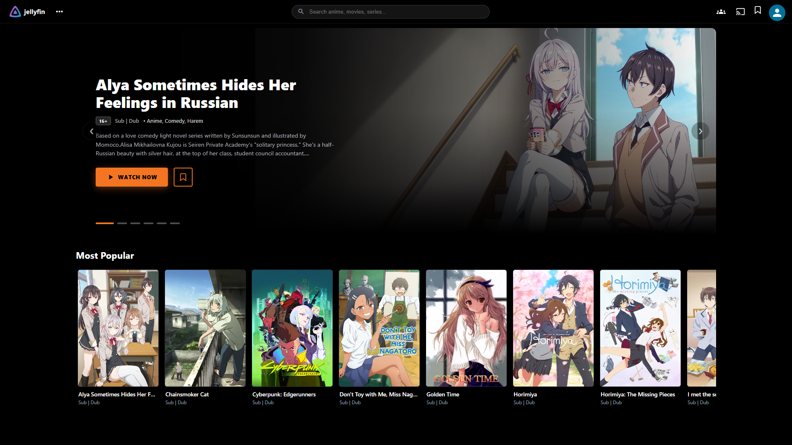
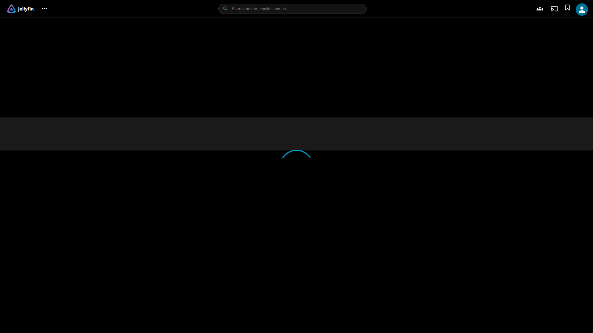
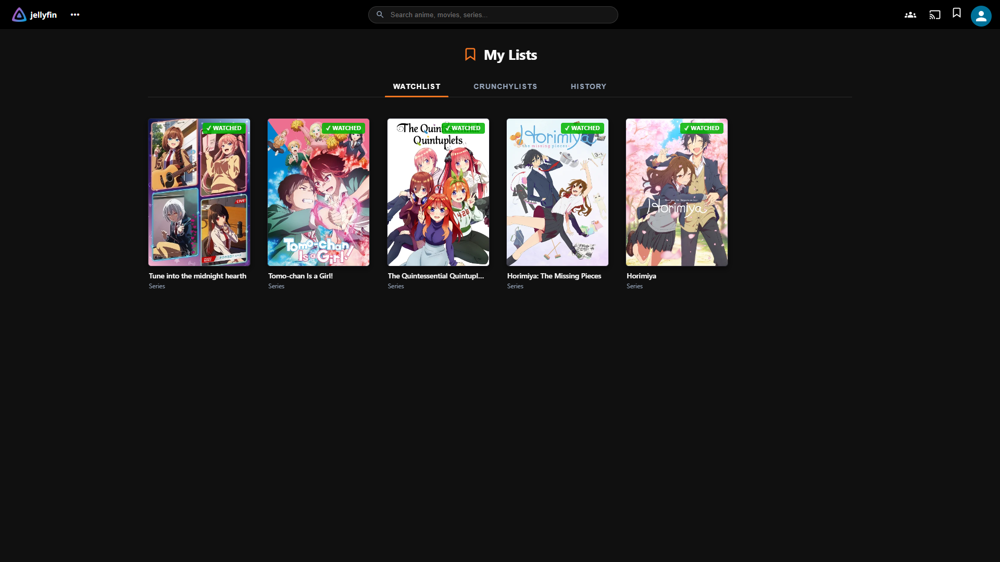

# 🍊 Crunchyfin

A **Crunchyroll-inspired theme** for [Jellyfin](https://jellyfin.org/) that transforms the default web client into a sleek, anime-focused streaming experience.



## ✨ Features

### 🎬 Cinematic Hero Banner
- Full-width spotlight carousel with backdrop images
- Auto-rotating slides with smooth crossfade transitions
- Genre tags, descriptions, and quick-play buttons
- Navigation arrows and animated progress dashes

### 📺 Series Details Page
- Immersive hero banner with backdrop art
- Smart action button:
  - **START WATCHING E1** — for new series
  - **CONTINUE E{N}** — resumes from where you left off
  - **REWATCH E1** — when all episodes are watched
- Bookmark toggle and watched status indicator
- Episode grid with thumbnails, duration badges, and progress bars
- Season selector dropdown

### 📋 My Lists (`#/lists`)
- **WATCHLIST** — Shows all fully-watched series with `✓ WATCHED` badges
- **CRUNCHYLISTS** — Custom curated lists
- **HISTORY** — Watch history
- Empty state with Crunchyroll-style mascot illustration

### 🎨 UI Overhaul
- Dark theme with Crunchyroll orange (`#F47521`) accent
- Custom search bar in the header
- Bookmark icon in the toolbar for quick list access
- Clean layout — removes default Jellyfin sections and blurry backdrops
- Transparent video player background (fixes black screen on playback)





## 📦 Installation

### Prerequisites
- A running **Jellyfin** server (Docker recommended)
- **SSH access** to the Jellyfin host
- **Python 3.8+** with `paramiko` and `requests`:
  ```bash
  pip install paramiko requests
  ```
- A **Jellyfin API key** (Settings → API Keys → Add)

### Quick Install (Docker)

```bash
git clone https://github.com/L1ght045/Crunchyfin.git
cd Crunchyfin

python install.py \
  --host YOUR_SERVER_IP \
  --user SSH_USERNAME \
  --password SSH_PASSWORD \
  --api-key YOUR_JELLYFIN_API_KEY \
  --container Jellyfin
```

### Manual Install

1. Copy the contents of `crunchyroll.css` into **Jellyfin Dashboard → General → Custom CSS**

2. For full functionality (hero banner, My Lists, smart buttons), inject the JS:
   - Open `crunchyroll.js` and replace `YOUR_API_KEY_HERE` with your Jellyfin API key
   - Add both CSS and JS into your Jellyfin container's `/usr/share/jellyfin/web/index.html` before `</head>`:
     ```html
     <style>/* contents of crunchyroll.css */</style>
     <script>/* contents of crunchyroll.js */</script>
     ```

### Branding XML Method (CSS Only)

```bash
python install.py \
  --method branding \
  --host YOUR_SERVER_IP \
  --user SSH_USERNAME \
  --password SSH_PASSWORD
```

> **Note:** The branding method only applies CSS styling. JS features (hero banner, My Lists tabs, smart continue button) require the Docker injection method.

## 🔧 Configuration

Edit the top of `crunchyroll.js` to customize:

```javascript
var API_BASE = window.location.origin;  // Auto-detected
var AUTH_KEY = "YOUR_API_KEY_HERE";       // Replace with your API key
```

### CSS Variables

```css
:root {
  --cr-orange: #F47521;        /* Primary accent color */
  --cr-orange-hover: #FF8A3D;  /* Hover state */
  --cr-dark: #000000;          /* Background */
  --cr-card-bg: #141419;       /* Card backgrounds */
  --cr-text: #ffffff;          /* Primary text */
  --cr-text-muted: #94a3b8;    /* Secondary text */
}
```

## 📂 Project Structure

```
Crunchyfin/
├── crunchyroll.css      # Complete theme stylesheet
├── crunchyroll.js       # Dynamic UI (hero banner, My Lists, series details)
├── install.py           # Automated installer script
├── screenshots/         # Preview images
│   ├── home.png
│   ├── series-details.png
│   └── my-lists.png
└── README.md
```

## ⚠️ Notes

- After a Jellyfin container update, you may need to re-run the installer (container updates overwrite `index.html`)
- The WebSocket 403 warnings in the console are a standard Jellyfin behavior with API key auth and are harmless
- Tested with Jellyfin 10.10.x (LinuxServer Docker image)

## 🤝 Contributing

Contributions are welcome! Feel free to open issues or submit pull requests.

## 📄 License

MIT License — see [LICENSE](LICENSE) for details.
